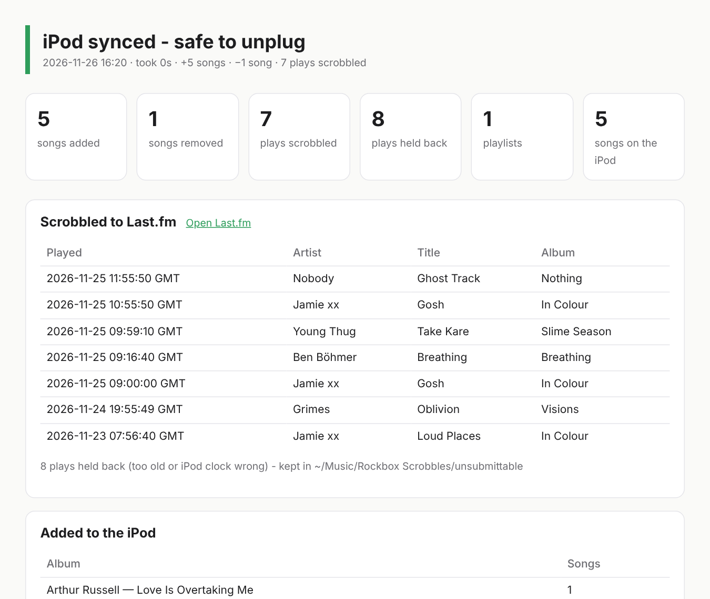

# iPod Sync

Plug a [Rockbox](https://www.rockbox.org) iPod into your Mac and it looks after itself:

- **Music** – your library folder is mirrored onto the iPod (new albums copied, deleted ones removed)
- **Playlists** – `.m3u8` playlists from your Mac are written to the iPod
- **Last.fm** – everything you played on the iPod is scrobbled, with the right times
- **Backups** – your Rockbox settings and on-device playlists are copied to the Mac
- **Feedback** – a notification when it's safe to unplug, and a report of what happened

No iTunes or Music app involved: the iPod is just a drive, and a small background job does the work when it's plugged in.



---

## What you need

| | |
|---|---|
| **An iPod running Rockbox** | Check your model is supported on [rockbox.org](https://www.rockbox.org), then install it with **[Rockbox Utility](https://www.rockbox.org/wiki/RockboxUtility#Download)** – pick the download for your computer. Full instructions are in the [Rockbox manual](https://www.rockbox.org/manual.shtml) for your model. |
| **A Mac** | macOS 12 or newer, with [Homebrew](https://brew.sh) and Apple's Command Line Tools (`xcode-select --install`). |
| **Your music in folders** | e.g. `Music Library/Artist/Album/01 Song.mp3`. Good tags matter (the Last.fm names come from them) – [MusicBrainz Picard](https://picard.musicbrainz.org) is a good free tagger. |
| **A Last.fm account** | Optional – everything else works without it. |

> **What this was built and tested on:** iPod mini 2nd gen with an SD-card adapter, Rockbox 4.0 installed with Rockbox Utility for macOS, on macOS 26 (Apple Silicon). Other Rockbox iPods should work the same way – if you try one, please open an issue saying how it went.

### Rockbox settings on the iPod

Set these once on the iPod (menu names are from Rockbox 4.0):

| Setting | Value | Why |
|---|---|---|
| **Settings → Playback Settings → Logging** | On | Records what you play – this is what gets scrobbled |
| **Settings → General Settings → System → USB Mode** | Mass Storage | So it shows up as a drive when plugged in |
| **Settings → General Settings → Database → Auto Update** | Yes | Picks up new albums when the iPod starts |
| **Settings → General Settings → System → Time & Date** | Correct time | Last.fm rejects plays with wrong dates |

You don't need Rockbox's own Last.fm plugin – the Mac reads the play log directly.

---

## Install

```bash
git clone https://github.com/tombarker97/ipod-sync.git
cd ipod-sync
./install.sh
```

The installer:

1. checks for Homebrew, rsync and Python, and offers to install `terminal-notifier` (clickable notifications)
2. asks for your iPod's name, library folder, playlists folder and time zone (it suggests sensible answers)
3. offers to download [rb-scrobbler](https://github.com/Jeselnik/rb-scrobbler) and connect it to Last.fm – you approve access on the Last.fm website; your password is never handled
4. builds a tiny app, **iPod Sync.app**, in `~/Applications`, and sets it to run whenever a drive is mounted
5. asks macOS for permission to read the iPod (if it's plugged in) – click **Allow** on *"iPod Sync would like to access files on a removable volume"*

**Then do a practice run** with the iPod plugged in – it changes nothing and shows what would happen:

```bash
ipod-sync --dry-run
```

---

## Using it

Plug in the iPod and wait for the notification:

1. **"Syncing… don't unplug"**
2. **"Safe to unplug"** – the iPod has been ejected (Last.fm uploading carries on without it)
3. **A summary**, e.g. *"iPod synced – safe to unplug: +12 songs · 34 plays scrobbled"*. Click it to open the report.

The report is at `~/Music/iPod Sync/Last sync.html`: what was scrobbled, albums added and removed, playlists, anything that needs attention, and your recent syncs. If something goes wrong it opens by itself.

| Command | What it does |
|---|---|
| `ipod-sync --dry-run` | Show what a sync would do, without changing anything |
| `ipod-sync --real` | Run a sync now (and see its output) |
| `ipod-sync --check` | Check the app is allowed to read the iPod |
| `ipod-sync --export-playlists` | Copy your Apple Music playlists into your playlists folder (one-off) |
| `ipod-sync --help` | Show where the settings and log are |

---

## Last.fm

- When you plug in, the play log is read from the iPod, turned into scrobbles, archived on the Mac, and **cleared on the iPod**.
- A play counts if the track is over 30 seconds and you listened to at least half of it, or 4 minutes – Last.fm's rules.
- Names come from your files' tags, and times are converted from the iPod's clock using your time zone, summer time included. Rockbox doesn't change its clock for summer time by itself, so set the iPod's clock when the clocks change.
- Scrobbles appear on Last.fm **at the time you listened**, not the time you synced – look in your history for that day.
- **Last.fm only accepts plays from the last 14 days**, so plug in at least every two weeks. Older plays, and plays with impossible dates (iPod clock not set), are kept in `~/Music/Rockbox Scrobbles/unsubmittable/` rather than lost.
- If the upload fails (e.g. no internet), plays wait in `pending/` and go next time – a play is never sent twice. The odd play Last.fm itself rejects is kept in `unsubmittable/` and not retried.

## Playlists

Put `.m3u8` playlists in your playlists folder (default `~/Music/Playlists`). Each line is a path inside your library:

```
Radiohead/In Rainbows/01 15 Step.mp3
Radiohead/In Rainbows/02 Bodysnatchers.mp3
```

Each sync writes them to the iPod's `/Playlists` folder in Rockbox's format. Deleting one on the Mac removes it from the iPod; playlists you made on the iPod itself are left alone. Coming from Apple Music? `ipod-sync --export-playlists` converts your playlists once (add `--include-smart` for smart playlists).

## What's kept on your Mac

| Folder | Contents |
|---|---|
| `~/Music/iPod Sync/` | The sync report and history |
| `~/Music/Rockbox Scrobbles/` | Archive of every play log, the Last.fm queue, plays that couldn't be sent |
| `~/Music/RockboxBackup/` | Rockbox settings (`config.cfg`) and playlists from the iPod – last 10 syncs |
| `~/Library/Logs/ipod-sync.log` | Detailed log of every sync (a new one is started past 2 MB; the previous one is kept as `ipod-sync.log.1`) |

## Settings

Your settings live in `~/.config/ipod-sync/config` – edit them any time. The main ones:

| Setting | Default | |
|---|---|---|
| `IPOD_NAME` | `IPOD` | The iPod's name in Finder |
| `SRC` | `~/Music/Music Library/` | Library copied to the iPod's `/Music` |
| `PLAYLISTS` | `~/Music/Playlists` | Playlists to put on the iPod |
| `IPOD_TZ` | your Mac's time zone | Time zone the iPod's clock is set to |
| `LASTFM_USER` | – | Adds a Last.fm link to the report |
| `DRY_RUN` | `no` | `yes` makes every sync a practice run |
| `BACKUP` / `KEEP_BACKUPS` | `~/Music/RockboxBackup` / `10` | Where settings backups go, and how many to keep (only the dated backup folders in it are ever deleted) |
| `DO_FILES` / `DO_PLAYLISTS` / `DO_SCROBBLES` / `EJECT` | `yes` | Switch parts on or off |
| `SOUNDS` | `yes` | Start / done / problem sounds |
| `OPEN_REPORT` | `problems` | Open the report `never`, on `problems`, or `always` |

Yes/no settings also accept `true`/`false`, `1`/`0` and `on`/`off`. If the file has a mistake in it (a missing quote, a folder that would copy your whole disk), the sync doesn't run and a notification says what to fix; a setting name it doesn't recognise is listed in the report.

## How it works

When any drive is mounted, macOS starts **iPod Sync.app**. If the drive isn't your iPod it stops straight away. Otherwise it:

1. backs up the iPod's Rockbox settings and playlists
2. collects plays from the iPod's play log (before any files change)
3. copies new and changed music to the iPod's `/Music`, then removes songs that are no longer in your library
4. writes your playlists
5. tidies up macOS's hidden `._` files, then ejects the iPod
6. uploads plays to Last.fm
7. shows the summary and writes the report

**Why an app?** macOS only lets programs read external drives with your permission, and it gives that permission to whichever program started the job. The app is a few lines of code ([`app/launcher.c`](app/launcher.c)) that runs the sync scripts, so you grant one narrow permission – *removable volumes, for iPod Sync only* – instead of Full Disk Access for bash or Python. It's built on your Mac by the installer, so there's no downloaded binary to trust.

**Only `/Music` and `/Playlists` are managed.** Anything else on the iPod (including the `.rockbox` system folder) is never changed, apart from clearing the play log after it has been safely archived.

## Updating and uninstalling

```bash
cd ipod-sync && git pull && ./install.sh     # update – your settings are kept
./uninstall.sh                               # remove – your music, archive and backups are kept
                                             #   (add --delete-settings to remove your settings too)
```

## Troubleshooting

See **[docs/troubleshooting.md](docs/troubleshooting.md)** – nothing happening on plug-in, permission prompts, "USB keypad mode", "Database not ready", missing scrobbles and more.

## Credits

- [Rockbox](https://www.rockbox.org) – the firmware that makes all of this possible
- [rb-scrobbler](https://github.com/Jeselnik/rb-scrobbler) by Jeselnik – uploads the scrobbles (downloaded separately, under its own licence)
- [mutagen](https://github.com/quodlibet/mutagen) – reads the music tags

Licensed under the [MIT licence](LICENSE).
